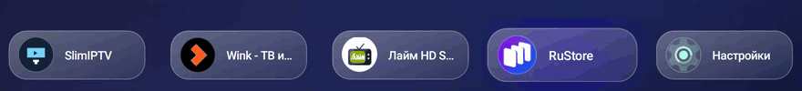

# Изменения

## 4.8

- у **каждой плитки своя анимация фокуса** (класс `TileFx`, 8 стилей, стиль стабилен для пакета):
  пружинистое увеличение, наклон, подъём, двойной пульс, сдвиг, «переворот», дрожание, поворот;
- под сфокусированной плиткой загорается **цветное свечение** цветом её иконки (`halo`);
- появление иконок и «дыхание» в покое остались как были.

