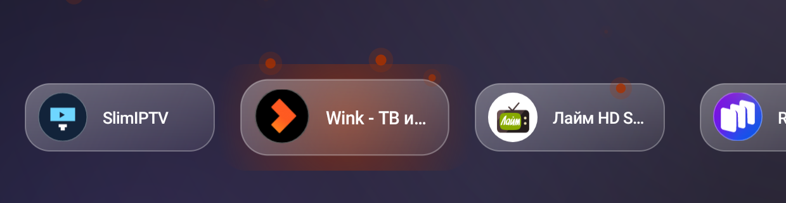

# Изменения

## 5.0

- **искры**: при выборе плитки от неё разлетаются частицы цвета иконки (класс `SparksView`, 26 частиц, гравитация и затухание);
- **звук**: короткий системный «клик» навигации при переходе между плитками (`FX_FOCUS_NAVIGATION_UP`);
- цветное свечение под плиткой и уникальная анимация движения остаются.

## 4.8

- у каждой плитки своя анимация фокуса (8 стилей), свечение цветом иконки.