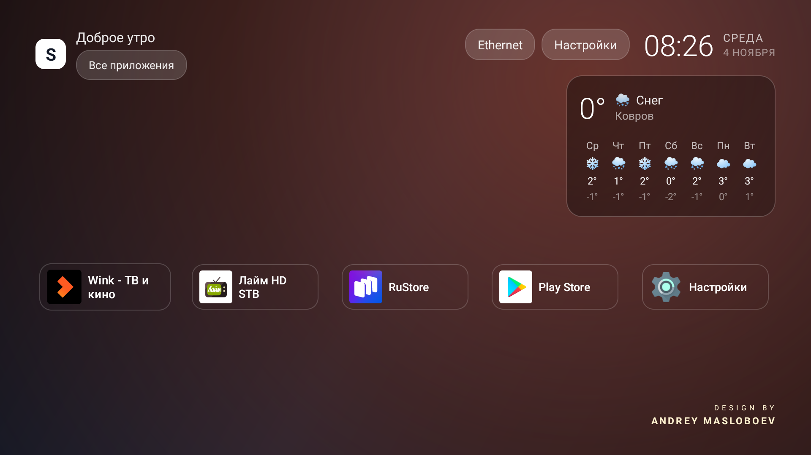

# SlimHome — Android TV launcher

A lightweight launcher for TV boxes: app grid, geolocated weather, ambient background tint, quick-access
buttons and a custom boot animation. Written in Java with no third-party libraries — **35 KB APK**,
no ads, no analytics, no accounts.



## Features

- **App grid** — 3 to 5 columns depending on screen size; the frame hugs the icon and label, gaps are equal,
  tiles appear in a staggered animation on launch.
- **Weather** — city detected by IP, multi-day forecast with icons; sources: `wttr.in`, fallback `open-meteo`.
  No API keys, no location permission.
- **Ambient tint** — the whole background fades to the average color of the focused app icon.
- **Top bar** — network (Ethernet/Wi-Fi), clock, date, Settings and Network shortcuts. Buttons share one
  standard size and switch to dark text on white when focused.
- **All apps** — a full-screen list opened from the top-left corner.
- **Author signature** — animated color shimmer with a winking easter egg on hover.
- **Startup intro** — a short animated intro on cold start (throttled to once per 30 minutes).
- **Responsive** — verified at 1920×1080 and at 720×576 (composite output on older TVs): columns, paddings,
  font sizes and weather card width are recalculated for the actual screen.

## Install

```bash
adb install -r release/SlimHome-1.0.apk
adb shell cmd package set-home-activity --user 0 com.slimhome.launcher/.MainActivity
```

Requirements: Android TV 8.0+ (API 26), ARM.

## Build

```bash
# JDK 17 + Android SDK platform 34, build-tools 34.0.0
./gradlew assembleRelease
```

See [docs/BUILD.md](docs/BUILD.md).

## License

MIT — see [LICENSE](LICENSE). Design and code by **Andrey Masloboev**.