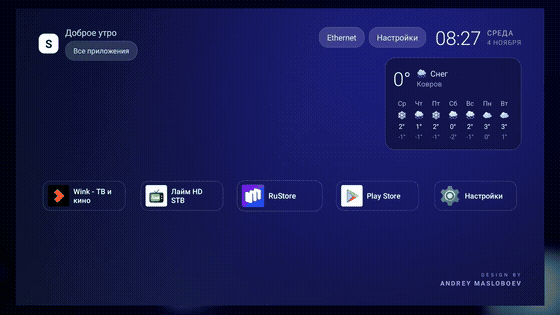
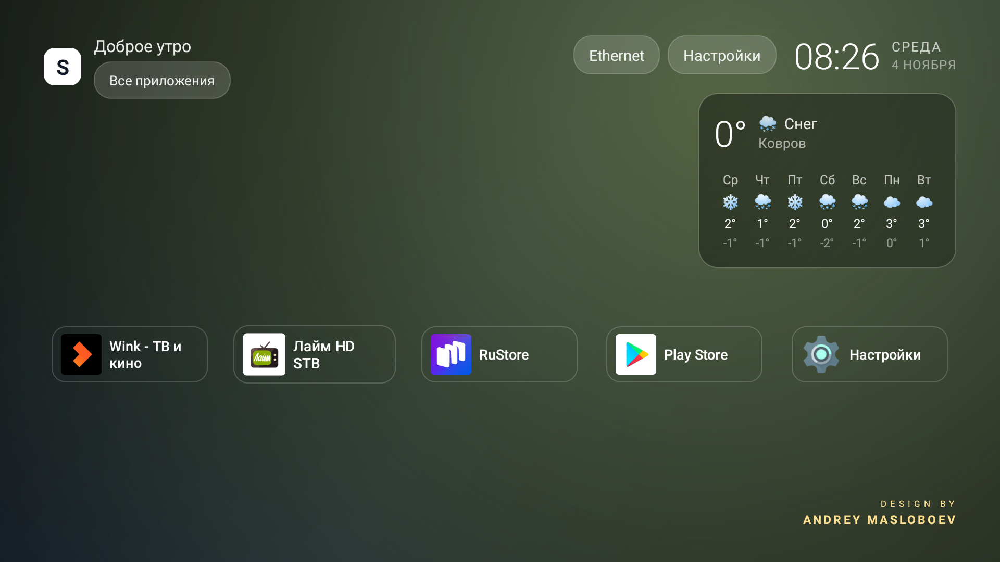

# SlimHome — лаунчер для Android TV

[](LICENSE)
[](https://github.com/mosloboev444-hue/slimhome/releases/latest)
[](https://developer.android.com/tv)
[](https://github.com/mosloboev444-hue/slimhome)
[](https://mosloboev444-hue.github.io/slimhome/)

Лёгкий лаунчер для ТВ-приставок: сетка приложений, погода по геолокации, подсветка фона под цвет иконки,
кнопки быстрого доступа и своя заставка при загрузке. Написан на Java без сторонних библиотек — **35 КБ APK**,
без рекламы, аналитики и аккаунтов.



## Скачать

**[SlimHome-1.1.apk](https://github.com/mosloboev444-hue/slimhome/releases/download/v1.1/SlimHome-1.1.apk)** · Android TV 8.0+ · ARM · [сайт проекта](https://mosloboev444-hue.github.io/slimhome/)

```bash
adb install -r SlimHome-1.0.apk
adb shell cmd package set-home-activity --user 0 com.slimhome.launcher/.MainActivity
```

Вернуть прежний лаунчер:

```bash
adb shell cmd package set-home-activity --user 0 <пакет.старый/активити>
```

## Возможности

- **Сетка приложений** — 3–5 колонок в зависимости от разрешения, рамка обтягивает логотип и название,
  равные отступы, каскадное появление при запуске.
- **Погода** — город определяется по IP, прогноз на несколько дней, иконки и температуры.
  Источники: `wttr.in`, при недоступности — `open-meteo`. Без ключей API и разрешений на геолокацию.
- **Подсветка фона** — при выборе приложения фон плавно перекрашивается в его цвет (средний цвет иконки).
- **Верхняя панель** — сеть (Ethernet/Wi-Fi), часы, дата, кнопки «Настройки» и переход в настройки сети.
  Кнопки одинакового размера, при фокусе — тёмный текст на белом.
- **Все приложения** — полноэкранный список по кнопке в левом верхнем углу.
- **Интеграция с SlimIPTV** — плеер закреплён первым на главном экране и запускается автоматически после включения приставки.
- **Подпись автора** — переливающийся градиент и пасхалка: при наведении появляется подмигивающий смайлик.
- **Интро при старте** — короткая анимация при холодном запуске (не чаще раза в 30 минут).
- **Адаптивность** — отдельно проверено на 1920×1080 и на 720×576 (композитный выход, «тюльпаны»):
  колонки, отступы, шрифты и ширина карточки погоды пересчитываются под экран.

| Экран | Скриншот |
|---|---|
| Главный экран |  |
| Все приложения |  |
| Подсветка под цвет иконки |  |
| Режим 576i (старый ТВ) |  |

## Сборка

```bash
# нужен JDK 17 и Android SDK с platform 34, build-tools 34.0.0
./gradlew assembleRelease
# APK: app/build/outputs/apk/release/app-release.apk
```

Подробнее — [docs/BUILD.md](docs/BUILD.md).

## Что внутри

```
app/src/main/java/com/slimhome/launcher/
  MainActivity.java   — экран, сетка, фокус, часы, погода, адаптивность
  Weather.java        — источник погоды (wttr.in → open-meteo)
  IntroView.java      — интро при холодном старте
  FaceView.java       — рисованный смайлик-пасхалка
extras/bootanim/      — заставка для Amlogic (bootvideo) и init-скрипт сетевого ADB
docs/                 — видео-демонстрации и материалы
store/                — тексты и ассеты для публикации в магазинах приложений
```

## Демо

- [Презентация проекта](docs/demo-presentation.mp4) — 24 с, вертикальное видео.
- [Живая запись с приставки](docs/demo-live.mp4) — 27 с, листание плиток, панель приложений, пасхалка.

## Лицензия

MIT — см. [LICENSE](LICENSE). Политика конфиденциальности — [docs/privacy.md](docs/privacy.md).

Автор дизайна и кода: **Andrey Masloboev**.