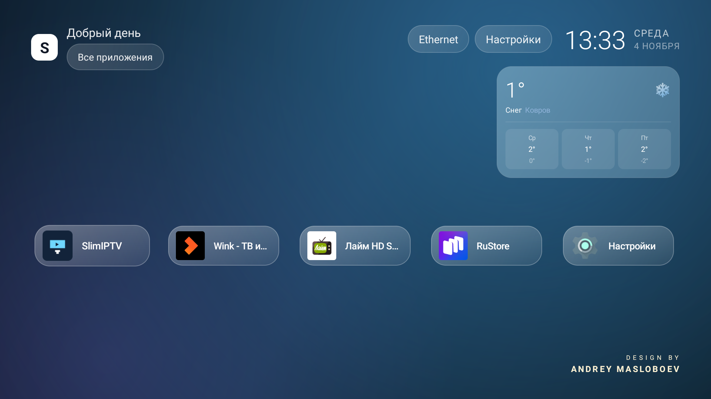
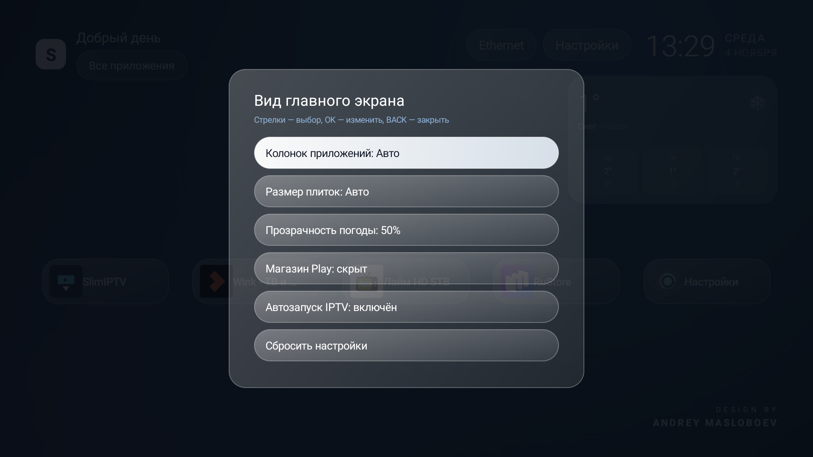
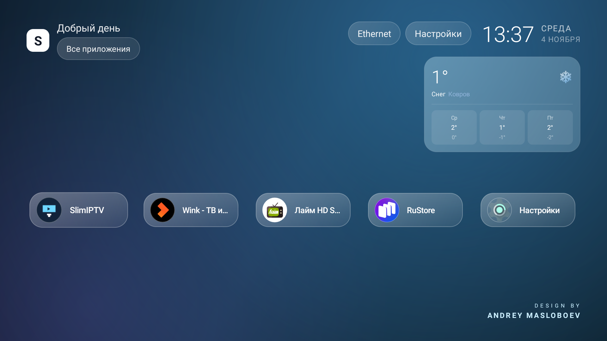
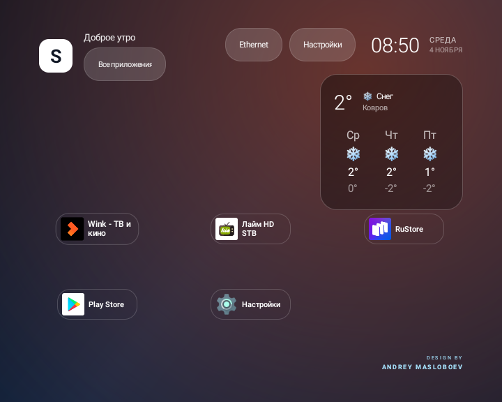

<div align="center">

# SlimHome

**Лаунчер для Android TV: сетка приложений, погода, стеклянный интерфейс.**

[](LICENSE)
[](https://github.com/mosloboev444-hue/slimhome/releases/latest)
[](https://developer.android.com/tv)
[](#)
[](https://mosloboev444-hue.github.io/slimhome/)

[Скачать APK](https://github.com/mosloboev444-hue/slimhome/releases/latest) · [Сайт проекта](https://mosloboev444-hue.github.io/slimhome/) · [Другие проекты](#экосистема)

</div>



## Что умеет

| | |
|---|---|
| **Сетка приложений** | 3–5 колонок под экран, плашки одинаковой ширины, подписи в одну строку |
| **Круглые иконки** | обрезка в круг со стеклянным кольцом, кэш, чтобы сетка строилась мгновенно |
| **Погода** | город по IP, прогноз чипами; фон карточки можно отключить или сделать прозрачным |
| **Стеклянный стиль** | полупрозрачные панели, блики, скругления, тёмный текст в фокусе |
| **Анимации** | появление с пружинкой, увеличение иконки в фокусе, «дыхание» в покое |
| **Подсветка фона** | фон перекрашивается в средний цвет иконки выбранного приложения |
| **Кнопка VPN** | зелёная, когда туннель поднят, красная — когда нет; открывает VPN-клиент |
| **Настройки вида** | колонки, размер плиток, прозрачность/фон погоды, автозапуск IPTV |
| **Адаптивность** | проверено на 1920×1080 и 720×576 (композит, «тюльпаны») |

## Пульт

| кнопка | действие |
|---|---|
| ◀ ▲ ▼ ▶ | навигация |
| OK | запуск; долгое OK на подписи — настройки вида |
| **1–5** | быстрый запуск: SlimIPTV, YouTube, Wink, Лайм HD, RuStore |
| ⌂ / ↩ | домой / назад |
| MENU | настройки вида |

## Скриншоты

| Главный экран | Настройки вида |
|---|---|
|  |  |

| Круглые иконки | Режим 576i |
|---|---|
|  |  |

## Установка

```bash
adb install -r SlimHome-2.9.apk
adb shell cmd package set-home-activity --user 0 com.slimhome.launcher/.MainActivity
```

Вернуть прежний лаунчер — той же командой с пакетом старого лаунчера.

## Сборка

Нужен JDK 17 и Android SDK platform 34:

```bash
./gradlew assembleRelease
```

Подпись — через `keystore.properties` (см. [docs/BUILD.md](docs/BUILD.md)). Без него release подписывается debug-ключом.

## Экосистема

| проект | что это |
|---|---|
| **SlimHome** | этот лаунчер |
| [SlimIPTV](https://github.com/mosloboev444-hue/slimiptv) | IPTV-плеер: 1252 проверенных канала, цифровой ввод, автопереключение мёртвых каналов |
| [SlimVPN](https://github.com/mosloboev444-hue/slimvpn) | VPN-клиент AmneziaWG с автоподключением при запуске YouTube |

## Лицензия

MIT — см. [LICENSE](LICENSE). Дизайн и код: **Andrey Masloboev**.
Политика конфиденциальности — [docs/privacy.md](docs/privacy.md).